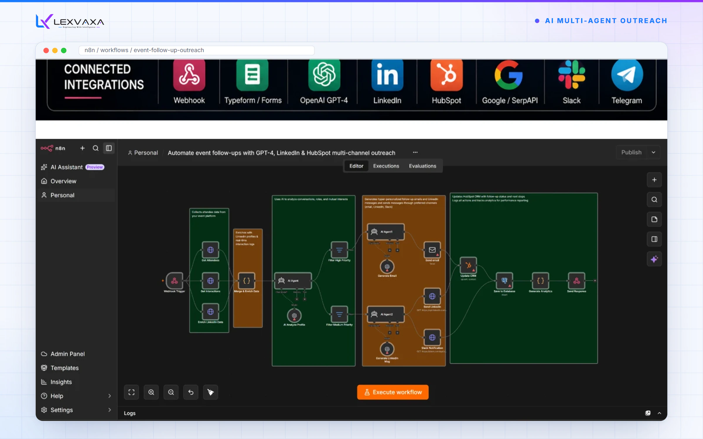

# AI Multi-Agent Event Follow-Up Outreach

**A multi-agent n8n system that researches event contacts, writes personal follow-ups with GPT-4 and runs outreach across LinkedIn, email and HubSpot.**

       

## Overview

Following up with every contact after an event took days of research and writing. Lexvaxa built a modular multi-agent system in n8n where specialist AI agents work together: event form responses arrive by webhook, one agent researches each contact with web search and LinkedIn, another writes a personal follow-up with GPT-4, and the system logs everything in HubSpot and sends the outreach across channels, with the team kept updated in Slack and Telegram. Screens shown use sample data, so no client records are exposed.

## The challenge

Event leads went cold because researching and writing personal follow-ups for each contact took too long.

## The solution

A multi-agent n8n architecture with OpenAI agents, event triggers, API and HTTP connections, and HubSpot, LinkedIn, Slack and Telegram integrations.

## Key features

- Multi-agent workflow architecture
- Event and trigger-based automation
- Contact research with web search and LinkedIn
- Personal follow-ups written by GPT-4
- Contacts and activity logged in HubSpot
- Multi-channel outreach
- Team updates in Slack and Telegram

## Results

- A structured system for orchestrating connected AI workflows after every event

## Tech stack

n8n · OpenAI GPT-4 · AI Agents · HubSpot · LinkedIn · Typeform · SerpAPI · Slack · Telegram

## Screens

## Privacy

Client names and records are confidential. Every screen in this repository uses sample data, and source code that belongs to the client is not published.

## Links

- Case study on Lexvaxa: https://lexvaxa.com/work/ai-event-follow-up-outreach
- Built by **Ch Muhammad Samiullah** ([GitHub](https://github.com/samiullah156-creator)) at [Lexvaxa](https://lexvaxa.com)
